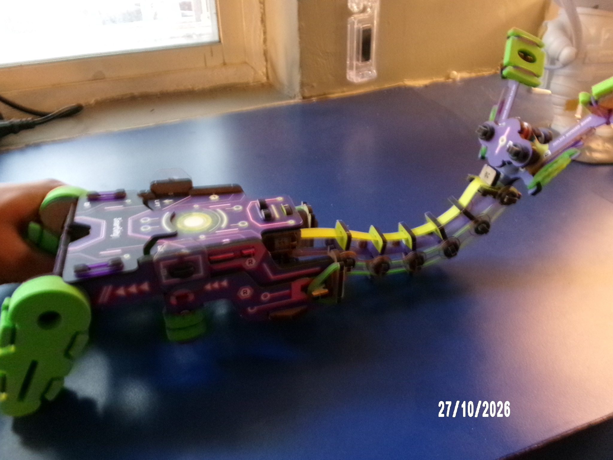

# TMJ — Too Many Joints 

### A DIY robotic arm project powered by curiosity, mechanics, and eventually AI.


## About the Project

**TMJ (Too Many Joints)** is an experimental robotics project based on the Smartivity Mechanical Robotic Arm kit.

The project begins with a manually operated robotic arm featuring a flexible neck and a mechanical gripper.

The long-term goal is to transform this mechanical system into an ESP32-powered robotic arm capable of motorized movement, computer control, and eventually autonomous gripping.

The name *Too Many Joints* reflects the project's playful approach to robotics and mechanical experimentation.

## Current Build

The original mechanical arm has been assembled.

It features two independently operated controls:

- **LIFT:** Curves the flexible arm upward.
- **GRAB:** Closes the mechanical gripper.

The arm uses mechanical linkages and elastic elements to transfer movement from the handles to the end effector.

### Hardware Available

- Smartivity Robotic Arm kit
- ESP32 development board
- MG996R metal-gear servo motors
- SG90 micro servo motors
- Breadboard and jumper wires
- External 5V power supply

## Project Goals

TMJ aims to explore how a simple mechanical toy can evolve into a programmable robotic system.

Planned capabilities include:

- Motorized arm bending
- Motorized gripper operation
- Independent control of LIFT and GRAB
- ESP32-based motor control
- Button-controlled operation
- Computer-based control using Python
- Wireless control over Wi-Fi
- Camera-based object detection
- Autonomous gripping experiments

## Development Roadmap

### Phase 1 — Mechanical Assembly

- [x] Assemble the robotic arm
- [x] Identify the LIFT and GRAB mechanisms
- [x] Test manual operation
- [x] Investigate motorization methods

### Phase 2 — Servo Experiments

- [x] Connect an MG996R servo to an ESP32
- [x] Test servo positioning
- [x] Test serial-controlled movement
- [ ] Select suitable actuators for both triggers
- [ ] Design secure motor mounts
- [ ] Calibrate safe trigger travel

### Phase 3 — Motorized TMJ and control

- [ ] Install LIFT actuator
- [ ] Install GRAB actuator
- [ ] Implement independent motor control
- [ ] Implement USB serial communication
- [ ] Add keyboard controls


## Technology Stack

**Hardware:** ESP32, servo motors, mechanical linkages, sensors (planned)

**Firmware:** Arduino C++, ESP32Servo

**Future Software:** Python, OpenCV, MediaPipe

## Repository Structure

```text
TMJ/
├── tmj.ino
├── README.md
├── .gitignore
└── images/
    └── tmj.jpg
```

## Future Vision

The goal is to develop TMJ from a manually operated mechanical arm into an intelligent robotic platform.

Future versions may combine embedded control, computer vision, sensor feedback, and autonomous decision-making.

TMJ is an ongoing experimental project. Features will be developed and documented as the hardware evolves.

---

**TMJ — Too Many Joints, one robotic idea at a time.**
